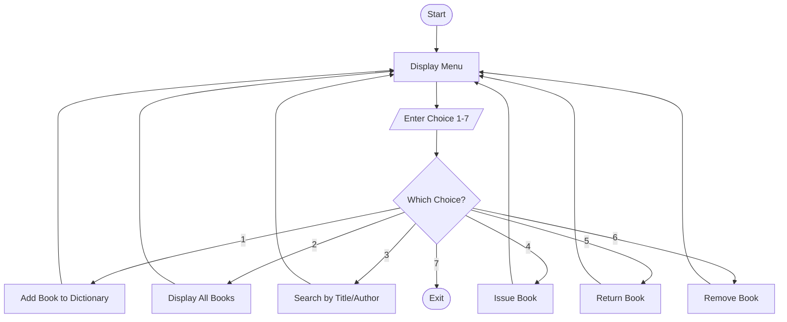

# Python PBL Projects


This repository contains two Project-Based Learning (PBL) projects written in Python.

| No. | Project | Concepts Used |
|-----|---------|---------------|
| 1 | Library Management System | String Manipulation, Functions, Lists, Dictionaries |

## Tech Stack

| Component | Details |
|-----------|---------|
| Language | Python 3 |
| Programming Paradigm | Procedural / Function-based |
| Interface | Command-Line Interface (text-based menu) |
| Data Structures | Lists, Dictionaries, Sets |
| Libraries | Python Standard Library only (no external packages) |
| Built-in Functions | `input()`, `print()`, `len()`, `sorted()`, `split()`, `strip()`, `title()`, `lower()` |
| Tools | Any text editor / IDE (VS Code, PyCharm, IDLE) |
| Version Control | Git and GitHub |

## How to Run

```bash
python library_management_system.py
python student_attendance_tracker.py
```

---

# Project 1: Library Management System

A menu-driven console application to manage a library. It stores each book in a
dictionary, uses functions for every operation, and applies string manipulation
for case-insensitive searching.

## Flowchart



## Algorithm

```
Step 1 : Start.
Step 2 : Create an empty dictionary named library.
Step 3 : Display the menu with options 1 to 7.
Step 4 : Read the user's choice.
Step 5 : If choice = 1, read Book ID; if ID exists show a message,
         else read title, author, quantity and store them in the
         dictionary with issued count = 0.
Step 6 : If choice = 2, if the library is empty show a message,
         else display all books in a formatted table.
Step 7 : If choice = 3, read a keyword, convert it to lowercase and
         print every book whose title or author contains the keyword.
Step 8 : If choice = 4, read Book ID; if a copy is available increase
         the issued count by 1, else show "no copies available".
Step 9 : If choice = 5, read Book ID; if any copy is issued decrease
         the issued count by 1, else show "none issued".
Step 10: If choice = 6, read Book ID and delete that book from the
         dictionary if it exists.
Step 11: If choice = 7, print goodbye message and stop.
Step 12: For any other choice, show "invalid choice".
Step 13: Repeat from Step 3 until the user chooses to exit.
Step 14: Stop.
```

## Sample Output

```
===== LIBRARY MANAGEMENT SYSTEM =====
1. Add Book
2. Display All Books
3. Search Book
4. Issue Book
5. Return Book
6. Remove Book
7. Exit
Enter your choice (1-7): 1
Enter Book ID: B101
Enter Book Title: The Alchemist
Enter Author Name: Paulo Coelho
Enter Quantity: 3
Book added successfully.

Enter your choice (1-7): 2
------------------------------------------------------------
ID      Title                 Author            Avail Issued
------------------------------------------------------------
B101    The Alchemist         Paulo Coelho      3     0
B102    Wings Of Fire         A P J Abdul Kalam 2     0
------------------------------------------------------------

Enter your choice (1-7): 3
Enter title or author to search: kalam
B102 | Wings Of Fire | A P J Abdul Kalam | Available: 2

Enter your choice (1-7): 4
Enter Book ID to issue: B101
'The Alchemist' issued successfully.

Enter your choice (1-7): 7
Exiting Library Management System. Goodbye!
```

---


## Author

[Manas Maity](https://github.com/maitymanas469-png)
